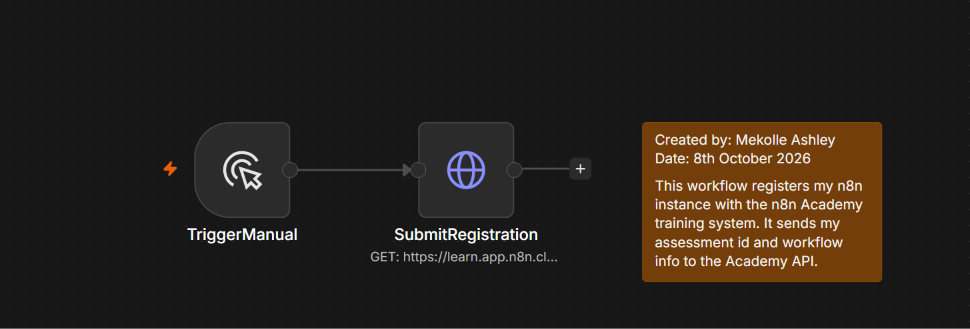
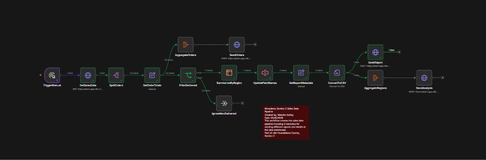

# N8N101 Essentials: Your First Workflows

First course of the n8n Foundations program: the n8n interface, triggers, credentials, and how data moves and transforms through workflows.

**Status:** Completed | Certificate: [view](../certificates/N8N101-certificate.pdf) | Badge: [verify](https://badges.n8n.io/e1b2e425-ee90-45e3-bb6c-2fd7b8bf7776#acc.Q1kjGz6T)

## Skills covered

- Navigating the canvas, nodes, connections and executions
- Manual triggers and HTTP requests with header authentication
- Credentials management
- n8n data structure (items and JSON)
- Splitting, mapping, filtering, summarizing and aggregating data
- Expressions for calculated fields and timestamps
- Binary data (converting data to a CSV file and sending it over HTTP)

## Projects

### 1. Academy Registration

**What it does:** Registers my n8n instance with the n8n Academy assessment system by sending my assessment ID, workflow name and course tag to the Academy API.

**How it works:** A manual trigger starts a GET request to the Academy registration endpoint. The request authenticates with a stored header auth credential and passes the registration details as query parameters.

**Nodes used:** Manual Trigger, HTTP Request (header auth, query parameters), Sticky Note for documentation

**Workflow file:** [01-academy-registration.json](workflows/Section-1-Academy-Registration.json)

### 2. Sales Data Pipeline

**What it does:** Pulls raw sales orders from an API, calculates order totals, and delivers three outputs to a data warehouse: the full order list, a regional sales analysis, and a CSV report.

**How it works:**

1. **Extract:** an authenticated HTTP request fetches the sales data, and Split Out turns the `orders` array into 50 individual items.
2. **Transform:** Edit Fields keeps the key fields (order ID, customer, region, status) and calculates `order_total` as `quantity × unit_price`.
3. **Branch 1, all orders:** Aggregate combines the 50 orders back into one payload and POSTs them to the warehouse.
4. **Branch 2, CSV report:** an IF node keeps the 17 delivered orders and routes the other 33 to a No Operation node. Summarize groups the delivered orders by region and calculates total sales, order count and average order value across 4 regions. Rename Keys gives the fields report-ready names, Edit Fields adds a generated timestamp, and Convert to File turns the result into a CSV that is sent as binary data.
5. **Branch 3, analysis:** the regional summary is aggregated into one `regions` payload and POSTed to the validation endpoint.

**Nodes used:** Manual Trigger, HTTP Request (GET and POST, JSON and binary bodies), Split Out, Edit Fields (Set), IF, No Operation, Summarize, Rename Keys, Aggregate, Convert to File, Sticky Note

**Workflow file:** [02-sales-data-pipeline.json](workflows/Section-2-Sales-Data-Pipeline.json)

## Running these workflows

The endpoints belong to the n8n Academy practice API. To run them yourself, replace `YOUR_ASSESSMENT_ID` with your own Academy assessment ID and connect your own header auth credential.

## What I learned

Building the sales pipeline showed me how n8n treats data as a list of items: splitting an array lets every node work on each record, while Aggregate and Summarize bring the items back together for reporting. Running one dataset through parallel branches to produce different outputs is the same pattern I use for client automations that feed several systems at once.
