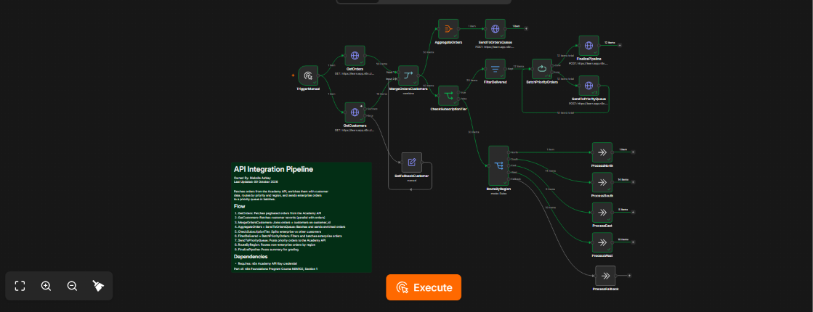
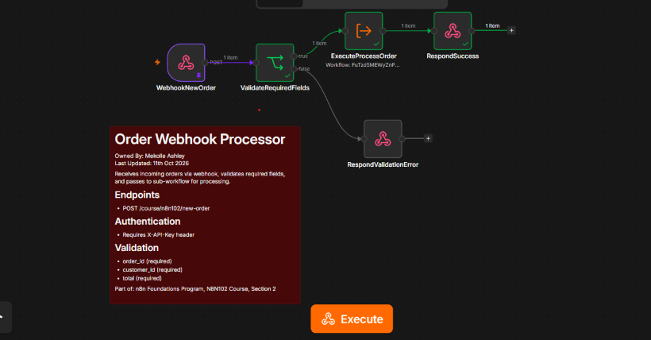
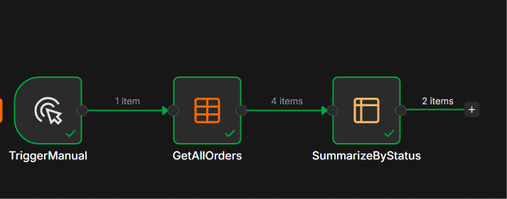

# N8N102 Integrations: APIs & Connected Workflows

Second and most technical course of the n8n Foundations program: connecting n8n to external services, controlling workflow logic, and building complete integrations.

**Status:** Completed | Certificate: [view](../certificates/N8N102-certificate.pdf) | Badge: [verify](https://badges.n8n.io/19174a82-6324-44ae-b102-740ba6887095#acc.d9AgcQ4V)

## Skills covered

- HTTP requests with header authentication and pagination
- Merging data from two APIs on a shared key
- Flow logic with IF, Filter, Switch and Loop Over Items (batching)
- Error outputs and fallback data
- Webhooks with authentication, validation and custom responses
- Sub-workflows with defined inputs and outputs
- Data Tables for storing and updating records
- Duplicate prevention

## Projects

### 1. API Integration Pipeline

**What it does:** Pulls orders and customers from two separate API endpoints, joins them into enriched orders, and routes them to different queues based on subscription tier and region.

**How it works:**

1. **Parallel extract:** one trigger starts two HTTP requests at once. Orders are fetched with page-based pagination (`page = $pageCount + 1`) so every page is collected, and customers are fetched in parallel.
2. **Error handling:** the customers request uses an error output. If it fails, a fallback customer record (Unknown Company, Starter tier, Unassigned manager) is passed on instead, so the pipeline keeps running.
3. **Join:** Merge enriches each order with its customer details by matching on `customer_id`.
4. **Branch 1, orders queue:** all enriched orders are aggregated into one payload and POSTed to the orders queue.
5. **Branch 2, priority queue:** an IF node separates Enterprise customers. Their orders that are not yet delivered are sent to the priority queue in batches of 5 using Loop Over Items. When the loop finishes, a summary is POSTed with the total order count, priority order count, batch size and retry setting.
6. **Branch 3, regional routing:** non-Enterprise orders go through a Switch node with named outputs for North, South, East and West, plus a fallback output for any unexpected region.

**Nodes used:** Manual Trigger, HTTP Request (GET with pagination, POST), Merge, Edit Fields (Set), Aggregate, IF, Filter, Loop Over Items, Switch, No Operation, Sticky Note

**Workflow file:** [01-api-integration-pipeline.json](workflows/01-api-integration-pipeline.json)

### 2. Order Processing System (webhook, sub-workflow and report)

Three workflows that work together as one order intake system.

#### 2a. Order Webhook Processor

**What it does:** Exposes an authenticated `POST /course/n8n102/new-order` endpoint that receives new orders, validates them and returns a proper API response.

**How it works:** the Webhook node requires an API key header and responds through Respond to Webhook nodes rather than immediately. An IF node checks that `order_id`, `customer_id` and `total` are all present. Invalid requests get a `400` JSON error that lists the required fields. Valid orders are passed to the Process Order sub-workflow, and the caller gets a `200` JSON response with the order ID, storage status and processing result.

**Nodes used:** Webhook (header auth), IF, Execute Workflow, Respond to Webhook (200 and 400)

**Workflow file:** [02-order-webhook-processor.json](workflows/02-order-webhook-processor.json)

#### 2b. Process Order (Sub-Workflow)

**What it does:** A reusable sub-workflow that stores each order exactly once, sends it for processing and returns the result to whichever workflow called it.

**How it works:**

1. Accepts three typed inputs: `order_id`, `customer_id` and `total`.
2. Looks up the order in a Data Table. If it already exists, the order is marked `skipped`, which prevents duplicates.
3. New orders are inserted with status `received` and a timestamp, then POSTed to the processing API.
4. The Data Table row is updated with the API's result and `processed_at` time.
5. A final Edit Fields node returns `order_id`, `stored`, `processing_result`, `processed_at` and the stored record to the parent workflow.

**Nodes used:** Execute Workflow Trigger (defined inputs), Data Table (get, insert, update), IF, HTTP Request, Edit Fields (Set)

.png)

**Workflow file:** [03-process-order-subworkflow.json](workflows/03-process-order-subworkflow.json)

#### 2c. Order Report

**What it does:** Reads every order from the Data Table and summarizes them by status, showing the order count and total value for each status.

**Nodes used:** Manual Trigger, Data Table (get all), Summarize

**Workflow file:** [04-order-report.json](workflows/04-order-report.json)

## Running these workflows

The endpoints belong to the n8n Academy practice API. To run them yourself:

1. Replace `YOUR_ASSESSMENT_ID` with your own Academy assessment ID.
2. Connect your own header auth credential.
3. Create a Data Table with the columns `order_id`, `customer_id`, `total`, `status`, `received_at` and `processed_at`, and select it in the Data Table nodes.
4. Import the Process Order sub-workflow first, then select it in the Execute Workflow node of the Webhook Processor.

## What I learned

This course moved me from single workflows to connected systems. A webhook that validates input and returns clear status codes, a sub-workflow that owns the storage logic, and a separate reporting workflow is the same separation of concerns I use when building back-end services. The error output with fallback data and the duplicate check showed me how to make automations that keep working when real-world data is messy.
