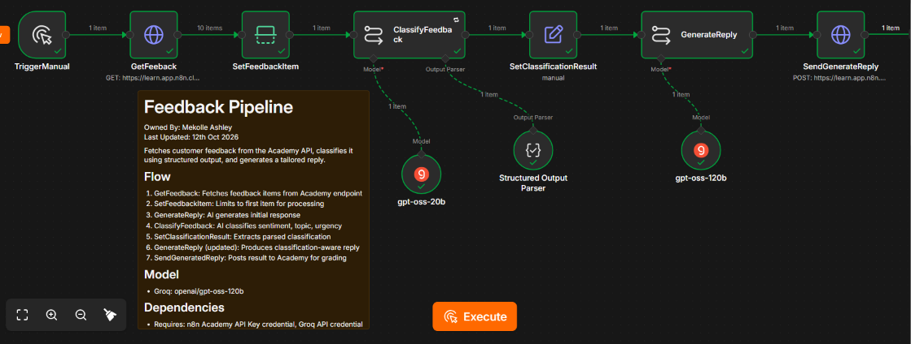
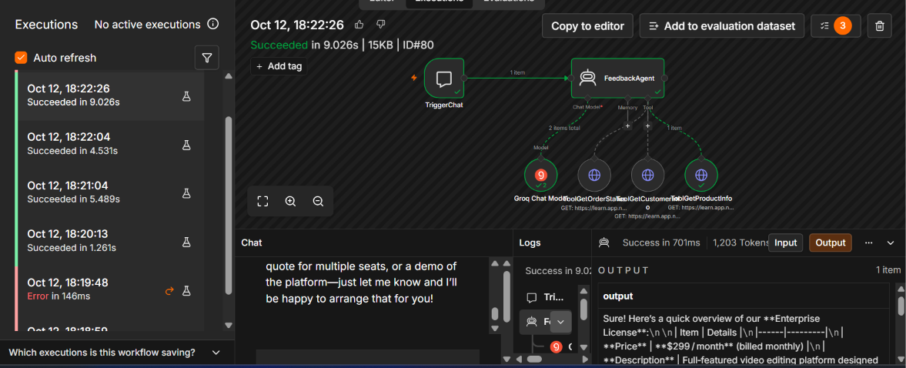
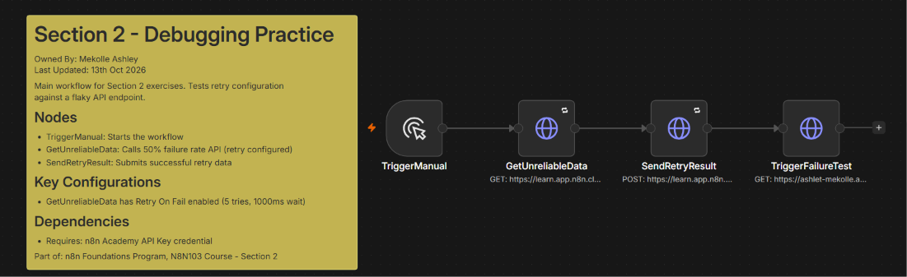
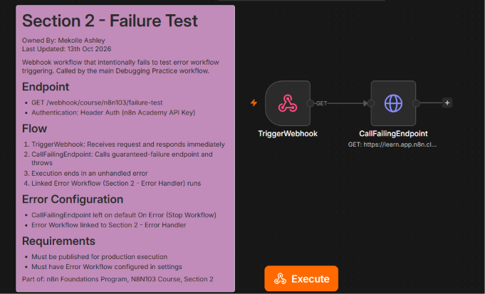
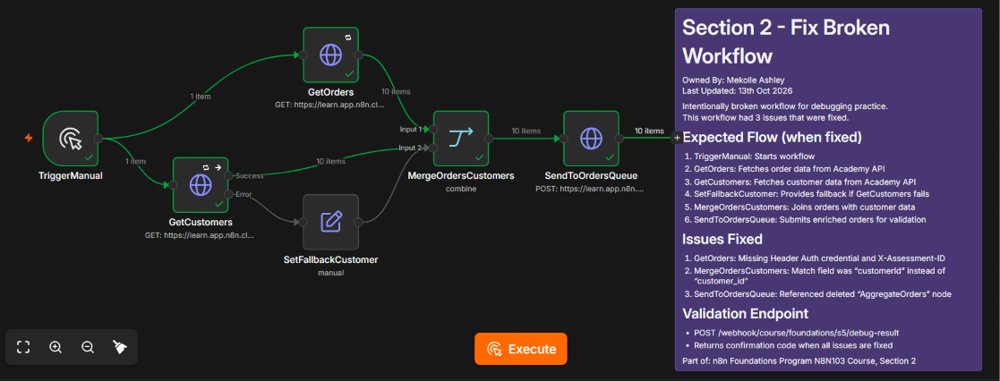

# N8N103 In Practice: AI, Testing & Best Practices

Third course of the n8n Foundations program: AI-powered workflows, debugging, error handling, and organizing workflows for production.

**Status:** Completed | Certificate: [view](../certificates/N8N103-certificate.pdf) | Badge: [verify](https://badges.n8n.io/1bd00129-c0ac-498b-969f-d699da1b3f58#acc.ZHvE71eT)

## Skills covered

- LLM chains with system prompts and dynamic user prompts
- Structured output parsing into typed JSON fields
- Choosing different models for different tasks
- AI Agent node with HTTP Request tools and `$fromAI()` parameters
- Retry on fail for unreliable APIs
- Error workflows with the Error Trigger
- Systematic debugging of a broken workflow
- Documentation with sticky notes and consistent node naming

## Projects

### 1. AI Feedback Pipeline

**What it does:** Fetches customer feedback, uses AI to classify it, then writes a reply whose tone matches the classification.

**How it works:**

1. An authenticated HTTP request fetches feedback, and a Limit node selects the item to process.
2. **Classify:** a Basic LLM Chain running `openai/gpt-oss-20b` on Groq labels the feedback by sentiment, topic, urgency and key issue. A Structured Output Parser forces the result into valid JSON with fixed allowed values, and the node retries automatically if the model returns bad output.
3. **Extract:** Edit Fields combines the parsed classification with the original feedback ID, customer name and message.
4. **Reply:** a second LLM Chain running the larger `openai/gpt-oss-120b` writes a 2 to 3 sentence response. The prompt adjusts tone using the classification: empathetic for negative or urgent feedback, warm for positive, and concrete next steps for billing or support.
5. The reply and classification are POSTed to the Academy API.

**Design choice:** the smaller, faster model handles classification, which is a constrained task, and the larger model handles open-ended writing.

**Nodes used:** Manual Trigger, HTTP Request, Limit, Basic LLM Chain (x2), Groq Chat Model (x2), Structured Output Parser, Edit Fields (Set)

**Workflow file:** [01-feedback-pipeline.json](workflows/01-feedback-pipeline.json)

### 2. Customer Service AI Agent

**What it does:** A chat-based support agent that answers questions about orders, accounts and products by deciding which tool to call.

**How it works:** a Chat Trigger feeds messages to an AI Agent node. The system prompt defines the agent's role, tells it to ask the customer for any missing parameter, offers a handoff to a human agent when it cannot find an answer, and tells it never to reveal its tools. The agent has three HTTP Request tools, and each tool's description tells the model when to use it:

| Tool | Looks up | Parameter filled by AI |
|---|---|---|
| Order Status | Order and delivery status | `order_id` |
| Customer Info | Subscription plan, status and contact details | `customer_id` |
| Product Info | Features, pricing and specifications | `product_name` |

Each parameter is filled at runtime with `$fromAI()`, so the model extracts the value from the conversation.

**Nodes used:** Chat Trigger, AI Agent, Groq Chat Model, HTTP Request Tool (x3)

**Workflow file:** [02-customer-service-agent.json](workflows/02-customer-service-agent.json)

### 3. Error Handling and Monitoring System

Three workflows that show retries, failure handling and centralized error reporting working together.

#### 3a. Debugging Practice

**What it does:** Calls an API that fails about 50% of the time and makes the workflow succeed anyway.

**How it works:** the HTTP request has Retry On Fail enabled with 5 attempts, so temporary failures are retried automatically. The result is submitted with the confirmation code, and a final request then calls the Failure Test webhook to test the error workflow.

**Nodes used:** Manual Trigger, HTTP Request (retry on fail)

**Workflow file:** [03-debugging-practice.json](workflows/03-debugging-practice.json)

#### 3b. Failure Test

**What it does:** An authenticated webhook workflow that calls a guaranteed-failure endpoint on purpose, so the linked error workflow can be tested in production.

**How it works:** the failing node is left on the default Stop Workflow setting, so the execution ends with an unhandled error. The workflow settings link it to the Error Handler.

**Nodes used:** Webhook (header auth), HTTP Request

**Workflow file:** [04-failure-test.json](workflows/04-failure-test.json)

#### 3c. Error Handler (Error Workflow)

**What it does:** A central error workflow that runs whenever a linked workflow fails in production. It reports what went wrong and prepares an alert message.

**How it works:** the Error Trigger receives the failed workflow's name, ID, execution URL, error message and last node executed. These details are POSTed to an error reporting endpoint, then formatted into a readable alert such as *Workflow "X" failed at node "Y": message*. The alert is ready to send to Slack, and the final node is a placeholder for the Slack connection.

**Nodes used:** Error Trigger, HTTP Request, Edit Fields (Set), No Operation

.png)

**Workflow file:** [05-error-handler.json](workflows/05-error-handler.json)

### 4. Fixed Broken Workflow

**What it does:** An order and customer enrichment workflow that was handed over intentionally broken. I diagnosed it and repaired it.

**Issues found and fixed:**

1. **GetOrders** was missing its header auth credential and the `X-Assessment-ID` header.
2. **MergeOrdersCustomers** matched on `customerId` instead of `customer_id`, so no records joined.
3. **SendToOrdersQueue** referenced an `AggregateOrders` node that had been deleted. I replaced it with `$input.all().map(item => item.json)`, which collects every merged item directly.

The repaired workflow also keeps retry on fail for both API calls, and it has a fallback customer record if the customer request fails.

**Nodes used:** Manual Trigger, HTTP Request (x3), Merge, Edit Fields (Set)

**Workflow file:** [06-fixed-broken-workflow.json](workflows/06-fixed-broken-workflow.json)

## Running these workflows

1. Replace `YOUR_ASSESSMENT_ID` with your own Academy assessment ID, and connect your own header auth credential.
2. Add a Groq API credential for the AI workflows. Any provider with a chat model will also work if you swap the model nodes.
3. In the Customer Service Agent, enable the Groq Chat Model node after importing, because it is disabled in this export.
4. In Debugging Practice, replace `YOUR_INSTANCE` with your own n8n instance address.
5. Import the Error Handler first, publish it, then select it as the Error Workflow in the Failure Test settings. Error workflows only run on production executions, not manual test runs.

## What I learned

This course connected AI to the reliability skills that make automations usable in production. Structured output turns a model's free text into fields that later nodes can trust, and an agent is only as good as its tool descriptions. On the reliability side, retries handle temporary failures, error outputs handle expected ones, and an error workflow catches everything else, so no failure goes unnoticed.
